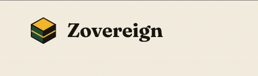

# Zovereign



Run your own Zcash mainnet infrastructure in **one Docker container**: an
archive Zakura node and lightwalletd, both bootstrapped from published snapshots.
lightwalletd connects to the RPC on your bundled Zakura node.

**[Visit the website](https://zcashlabs.github.io/zovereign/)**

## Install the CLI on macOS or Linux

To run a fresh mainnet node, Docker needs at least **4 CPUs, 15 GiB of usable RAM,
and 700 GiB free on its data volume**. If you use a remote server, these resources
belong on the server. [Run your own node with the CLI](docs/cli.md#run-your-own-zcash-mainnet-node)

**Installing a release?** Once the first signed CLI release is published, run
the command below on your Mac or in an SSH session on your Linux VM or bare-metal server.

```sh
installer=$(curl -fsSL --proto '=https' --proto-redir '=https' https://raw.githubusercontent.com/zcashlabs/zovereign/main/scripts/install-cli.sh) && /bin/sh -c "$installer"
```

The installer verifies the release signature and the checksum for your platform,
then installs `zovereign` in `~/.local/bin`. Open a fresh terminal or SSH session
and run `zovereign --version` to confirm the install.
[Build from source](docs/cli.md#build-from-source)

### Set up a node and connect your wallet

1. Start Docker on the node host. Run `zovereign check` to check its resources, then `zovereign up` to start guided installation. Later, `zovereign update --search` lists available updates and `zovereign update` updates the CLI and the node.
2. Run `zovereign status --watch` to follow the snapshot download, restoration, and chain sync. When it shows `ready`, press Ctrl+C to leave the watch.
3. Run `zovereign health` to confirm the node serves a recent compact block. Run `zovereign connect` to see the wallet endpoint and connection instructions.

For everyday use, see the [CLI commands for stats, logs, start/stop, diagnostics, updates, and rollback](docs/cli.md#commands).

**Reviewing a pull request?** You can run its CI binary as soon as the PR checks
pass. [Run the CLI from a pull request](docs/cli.md#try-a-pull-request)

## Quick start

Install Docker with the Compose plugin, then run:

```bash
git clone https://github.com/zcashlabs/zovereign.git
cd zovereign
docker compose up -d --build
```

No account, RPC credentials, or separate node is needed. The first start
downloads and verifies both snapshots, restores the databases, catches Zakura
up to the network, and starts lightwalletd. Later starts reuse the data;
interrupted downloads resume.

**Plan for SSD storage, 4 CPU cores, 16 GiB RAM, and a 1 TB data disk.** The
initial download is approximately 300 GB as of November 2026, with additional
space required during extraction. First startup can take hours.

The image supports **Linux amd64 and arm64**. Docker selects your architecture
automatically, including native ARM64 on Apple Silicon. macOS and Windows run
the Linux image through Docker Desktop; on Windows, use Linux containers and
run the commands in WSL 2. Allocate the resources above to Docker's VM.

CI builds and runs fixture and bundled-binary tests on both architectures.
A complete mainnet restore has been verified on Linux amd64; full-mainnet
validation on ARM64 and Docker Desktop is still pending.

## Run the published image directly

Without cloning the repository or building an image, run:

```bash
docker run -d \
  --name zovereign --restart unless-stopped --stop-timeout 120 \
  --log-driver json-file --log-opt max-size=20m --log-opt max-file=3 \
  --mount type=volume,src=zovereign-data,dst=/data \
  -p 8233:8233 -p 127.0.0.1:9067:9067 \
  ghcr.io/zcashlabs/zovereign:latest
```

The image is publicly pullable without a registry login. Choose this command
or Compose for a deployment; both use the same container and volume names.
Use a `sha-<full-commit>` image tag or digest to pin a specific tested build.

## Check readiness and connect

```bash
docker logs -f --tail=100 zovereign
docker inspect --format '{{.State.Health.Status}}' zovereign
```

Health remains `starting` during bootstrap. `healthy` means the node is near
the network tip and lightwalletd can serve an actual compact block through it.

Point a local wallet or gRPC client that supports a custom plaintext server at
`127.0.0.1:9067`. The default gRPC port is bound to your machine's loopback
interface. Port `8233` accepts Zcash peers; node RPC stays private inside the
container. For remote wallets, use a trusted tunnel or configure TLS using
[the deployment guide](docs/single-container.md#serving-remote-clients-with-tls).

The container includes grpcurl, so you can also query it directly:

```bash
docker exec zovereign grpcurl -plaintext 127.0.0.1:9067 \
  cash.z.wallet.sdk.rpc.CompactTxStreamer/GetLightdInfo
```

## Stop, resume, and update

For a Compose deployment:

```bash
docker compose stop          # Gracefully stop both services; keep data.
docker compose start         # Resume using the same databases.
```

To update the source and recreate the container:

```bash
git pull --ff-only
docker compose up -d --build
```

The persistent volume is named `zovereign-data`. Keep it across updates.
`docker compose down` also keeps it; **`docker compose down -v` permanently
deletes the databases and download progress**. Check release notes before
updating database versions; an incompatible database is refused rather than
silently replaced.

With the direct image command, stop and resume using `docker stop -t 120
zovereign` and `docker start zovereign`. For image updates, follow
[the guide](docs/single-container.md#updating-a-published-image).

## Configure and learn more

The defaults work without a configuration file. Optionally copy `.env.example`
to `.env` to change host ports, download concurrency, or the disk reserve, then
run `docker compose up -d --build` to apply changes.

- [Deployment guide](docs/single-container.md): plain Docker commands, storage,
  recovery, configuration, TLS, and full-mainnet validation.
- [Contributing](CONTRIBUTING.md): build and run the small fixture tests without
  downloading the blockchain, plus image publication instructions.
- [Agent instructions](AGENTS.md): repository map and implementation invariants.
- [Website source](website/README.md): the illustrated landing page and local
  preview instructions.
- [Snapshot creation and publishing](docs/snapshot-publishing.md): maintain the
  publisher or restore standalone lightwalletd against an existing RPC server.

This image bundles Zakura **1.8.7** (archive database major **30**) and
lightwalletd **v0.6.0**. Base images are pinned by digest; lightwalletd is built
from a fixed upstream commit with a verified source archive checksum. It passed 16
bootstrap and lifecycle tests and a complete mainnet restore on a clean Linux
VPS on 14 November 2026. lightwalletd loaded **3,571,794 cached blocks**, served
blocks near the bundled node's tip, and restarted without downloading again.

Snapshots skip the initial historical sync, so their imported history depends
on the publishers. SHA-256 verifies download integrity; it does not authenticate
the publisher. See the guide's
[trust boundary](docs/single-container.md#trust-and-validation-boundary).
